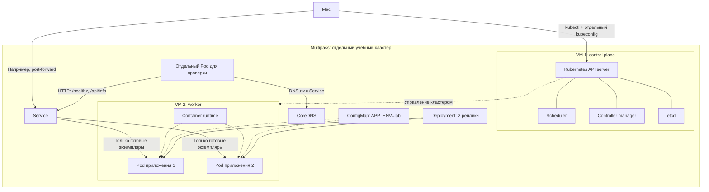

# Целевая схема стенда — день 1

Это целевая схема, а не подтверждение того, что стенд уже создан и проверен.

Обе реплики могут находиться на одном worker. Восстановление удалённого Pod не доказывает устойчивость к потере этого узла.
